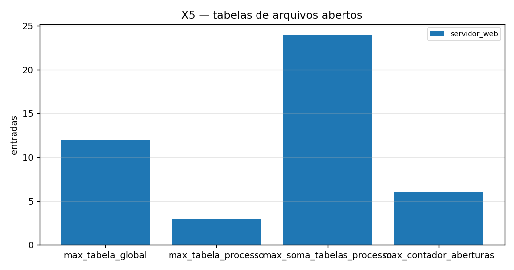
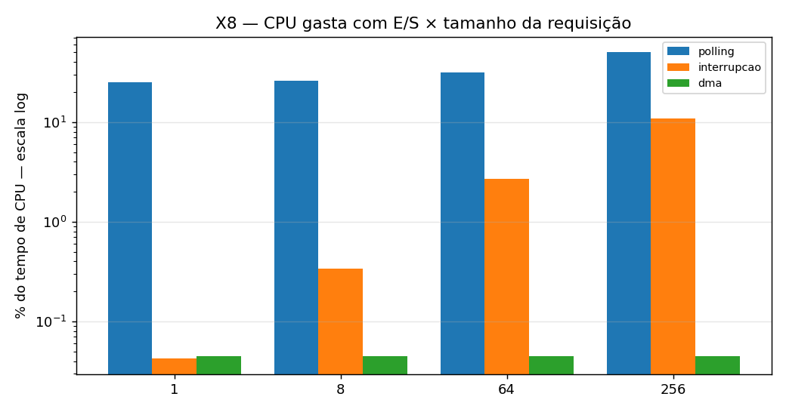
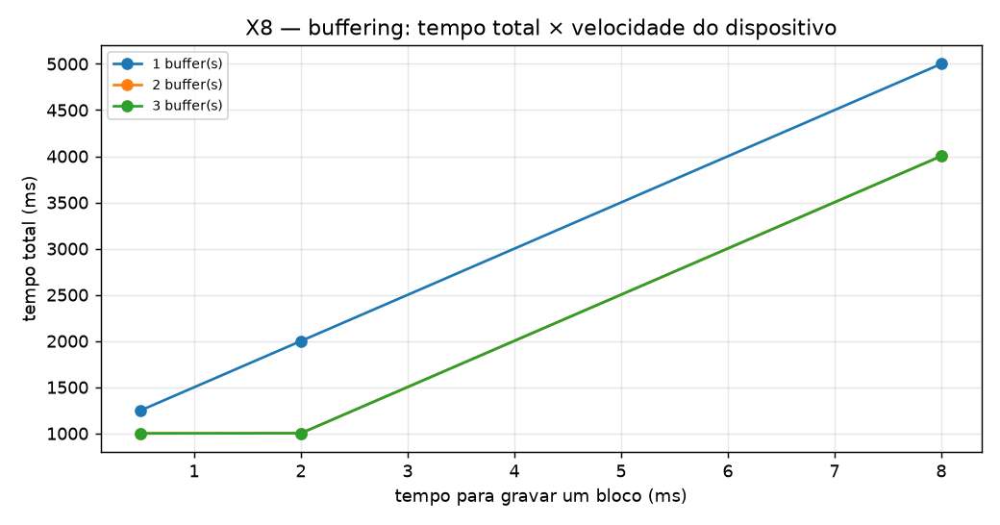

# Relatório — SimES: simulador de E/S e de sistema de arquivos

**Integrantes:** Gabriel Ribeiro Kowaleski, Jully Anne Seyffert da Silva Jara, Maria Rita Rodrigues, Mayra Bordin de Abreu

**Repositório:** https://github.com/MRita011/T2-SISOP

## 0. Resumo

O trabalho implementou e avaliou o subsistema de E/S e o sistema de arquivos do SimES, incluindo SSTF, SCAN, polling, interrupção e as operações do sistema de arquivos. Foram desenvolvidos também os módulos M1 (cache de blocos), M3 (DMA e buffering) e M4 (links e compartilhamento), além da integração ponta a ponta obrigatória. Os experimentos mostraram que o desempenho das políticas depende fortemente do padrão de acesso e da carga. No X12, a cache LRU alcançou cerca de 90,4% de acertos na carga `compilador`, mas apenas cerca de 5% em `banco_dados`. No X8, o DMA manteve baixo e praticamente constante o custo de CPU conforme o tamanho das requisições aumentou. Os resultados também mostraram diferenças importantes entre FCFS, SSTF e SCAN e entre as políticas de cache e escrita.

## 1. Escopo realizado

| Parte | Situação | Observação |
|---|---|---|
| N1 · Dispositivo (fornecido) | usado | — |
| N2 · Subsistema de E/S (SSTF, SCAN, polling, interrupção) | completo | Implementação concluída e testes aprovados. |
| N3 · Sistema de arquivos | completo | Implementação concluída e testes aprovados. |
| N4 · Experimentos X1–X5 e relatório | completo | Experimentos executados, analisados e documentados no relatório. |
| M1 · Cache de blocos | completo | Implementação concluída e testes aprovados. |
| M3 · DMA e buffering | completo | Implementação concluída e testes aprovados. |
| M4 · Links e compartilhamento | completo | Implementação concluída e testes aprovados. |
| Integração (grupos de 4) | completo | Implementação concluída, teste aprovado e experimento X12 executado, analisado e com evidências geradas. |
| Bônus flash | não feito | — |

Resultado dos testes automáticos (`python3 executar.py testes`): Ran 29 tests in 0.035s — OK (skipped=4)

Os quatro testes ignorados correspondem a M2, M5 e M6, que não fazem parte dos módulos escolhidos pelo grupo.

## 2. Implementação

### N2 — Subsistema de E/S

**Onde:** `simes/es/escalonadores.py`, nos escalonadores SSTF e SCAN, e `simes/es/cpu.py`, no cálculo dos custos de polling e interrupção.

**Decisões:** No SSTF, a escolha da próxima requisição foi feita considerando a menor distância em relação à posição atual do braço do disco. No SCAN, foi mantida a direção do movimento enquanto existiam requisições naquele sentido e, quando necessário, a direção era invertida. Para polling e interrupção, foram seguidas as regras de custo já definidas pelo simulador, mantendo cada forma de tratamento de E/S separada para permitir a comparação nos experimentos.

**Dificuldades:** O principal cuidado nessa parte foi manter corretamente a posição e a direção do braço durante o escalonamento, principalmente no SCAN. Também foi necessário seguir exatamente as fórmulas de custo previstas pelo simulador para que polling e interrupção apresentassem os resultados esperados nos testes.

### N3 — Sistema de arquivos

**Onde:** `simes/arquivos/sistema.py`, principalmente nas funções de resolução de caminhos e nas operações `mkdir`, `create`, `open`, `read`, `write`, `seek`, `close` e `unlink`, além das tabelas de arquivos abertos e dos testes complementares em `testes/test_n3_m4.py`.

**Decisões:** A resolução dos caminhos foi feita percorrendo os diretórios até localizar o arquivo ou diretório solicitado. Em `resolver`, o caminho `"/"` devolve `self.raiz` sem leituras de disco ($0$ acessos); nos caminhos profundos, os diretórios intermediários são lidos via `_ler_diretorio` ($1$ leitura de bloco por nível), com `ENOTDIR` para componente intermediário que não seja diretório e `ENOENT` para entrada inexistente.
- Criação de diretórios e arquivos (`mkdir` e `create`): ambos resolvem e leem os diretórios até o pai (inclusive) e verificam duplicidade (`EEXIST`). O `mkdir` aloca $1$ bloco para o novo diretório e realiza $2$ escritas (bloco do novo diretório e bloco do pai). O `create` calcula $\lceil \text{tamanho} / 4096 \rceil$ blocos via `_blocos_necessarios`, delega a reserva ao alocador sem gravar blocos de dados e faz $1$ escrita no diretório pai.
- Para os arquivos abertos, foram utilizadas uma tabela global, compartilhada entre os processos, e tabelas individuais por processo, onde cada abertura mantém sua própria posição e modo de acesso. Em detalhe, `self.tabela_global` indexa uma única `EntradaGlobal` por `fcb.id` e acumula em `contador` as aberturas simultâneas; `self.tabelas_processo[processo][handle]` mantém uma `EntradaProcesso` independente por descritor, com `modo` (`r`, `w`, `rw`, `a`) e `posicao` ($0$, ou `fcb.tamanho` no modo `'a'`). Os ganchos `_verificar_permissao` (no `open`) e `_verificar_trava` (no `read` e `write`) permanecem nos pontos exigidos pelo núcleo.
- As operações de leitura e escrita atualizam a posição do handle, enquanto o `seek` permite alterá-la diretamente. Especificamente, `seek` reposiciona o cursor em memória ($0$ acessos) e rejeita posições negativas (`EINVAL`); `read` limita o intervalo a `[posicao, min(posicao + n, fcb.tamanho))` e lê os blocos físicos correspondentes via `_blocos_do_intervalo`; `write` reposiciona no fim no modo `'a'`, chama `alocador.estender` se necessário, grava os blocos atingidos, atualiza `fcb.tamanho` e marca `fcb.sujo = True`. Os metadados são atualizados no `close` com $1$ escrita no bloco do diretório pai, que limpa `fcb.sujo`.
- Também foi mantida a regra de que um arquivo removido com `unlink` não tem seus blocos liberados enquanto ainda existir algum processo com ele aberto. A operação remove a entrada do diretório pai, decrementa `fcb.links` e grava o bloco do pai ($1$ escrita), mas bloqueia a remoção de diretórios com `EPERM`; quando `fcb.links == 0`, a liberação dos blocos e do FCB é imediata somente se o arquivo não estiver em `self.tabela_global`, ficando adiada até o `close` que zera `global_.contador` quando ainda há handles abertos (semântica POSIX).

**Dificuldades:** Essa foi uma das partes que exigiu mais atenção por causa da relação entre as várias operações. Além de fazer cada função funcionar individualmente, foi necessário manter corretamente as tabelas de arquivos abertos, a posição de cada handle e as regras de custo de acesso ao disco. Em particular, foi preciso garantir os custos corretos ao resolver o diretório pai em `mkdir`, `create` e `unlink` (sem leituras duplicadas ou faltantes quando o pai é `"/"` ou um subdiretório) e coordenar a liberação tardia entre `unlink` e `close` sem invalidar leituras de descritores ainda abertos.

### M4 — Links e compartilhamento

**Onde:** `simes/arquivos/sistema.py`, nas operações relacionadas a hard links, links simbólicos e travessia da árvore de diretórios, além dos testes complementares em `testes/test_n3_m4.py`.

**Decisões:** Nos hard links, diferentes nomes podem apontar para o mesmo arquivo, mantendo a contagem de links associada ao FCB. O método `link` resolve o arquivo de origem, rejeita diretórios com `ErroSA("EPERM")`, associa o novo nome ao mesmo `fcb.id`, incrementa `fcb.links` e grava o diretório pai ($1$ escrita), sem alocar blocos.
- Nos links simbólicos, foi criado um objeto próprio que guarda o caminho do alvo, permitindo inclusive que esse alvo ainda não exista. O método `symlink` cria um FCB de tipo `"simbolico"` sem blocos de dados (`fcb.alvo = alvo`) e grava o diretório pai ($1$ escrita). Em `resolver`, os componentes do alvo são antepostos aos componentes pendentes e a busca recomeça em `self.raiz`; ao seguir mais de `MAX_LINKS_SIMBOLICOS = 8`, a resolução termina com `ELOOP`. Componentes expandidos que não existem (`ENOENT`) incrementam `self.contadores["links_pendentes"]`; esse contador não é incrementado para falhas `ELOOP`.
- A travessia também considera links simbólicos para diretórios e registra situações de links pendentes e ciclos, evitando continuar indefinidamente quando um diretório já visitado é encontrado novamente. Em `percorrer`, a busca em profundidade mantém o conjunto `visitados` com os IDs dos diretórios vistos na travessia: cada diretório inédito incrementa `percorrer_diretorios` e é lido uma vez, arquivos incrementam `percorrer_arquivos`, e revisitas incrementam `ciclos_detectados` e interrompem a descida. Links simbólicos para diretórios são seguidos; falhas `ENOENT` ainda não contabilizadas em `resolver` incrementam `links_pendentes`.

**Dificuldades:** A parte mais delicada foi tratar os links simbólicos sem criar uma resolução infinita. Foi necessário diferenciar hard links de links simbólicos, identificar links cujo alvo não existe e controlar os diretórios já visitados durante a travessia para detectar ciclos sem continuar entrando no mesmo caminho. Também foi preciso preservar os componentes restantes de caminhos que atravessam links e distinguir ponteiros pendentes (`ENOENT`) de laços entre links (`ELOOP`).

### M1 — Cache de blocos

**Onde:** `simes/es/cache.py`.

**Decisões:** Foram implementadas as políticas LRU e FIFO para substituição dos blocos da cache, além das políticas de escrita `write-through` e `write-back`. A ideia foi manter separadas as decisões de qual bloco deve sair da cache e de quando uma escrita precisa chegar ao dispositivo. Também foi considerado o comportamento dos blocos modificados em situações de sincronização e queda de energia, conforme as regras previstas para o módulo.

**Dificuldades:** O principal cuidado foi diferenciar corretamente o comportamento de LRU e FIFO, já que no LRU o uso recente de um bloco interfere na ordem de substituição, enquanto no FIFO importa a ordem em que ele entrou na cache. Outro ponto importante foi manter clara a diferença entre `write-through` e `write-back`, principalmente em relação aos blocos que ainda estavam modificados na cache.

### M3 — DMA e buffering

**Onde:** `simes/es/cpu.py`, na parte referente ao DMA, e `simes/es/buffering.py`, na simulação dos buffers.

**Decisões:** Para o DMA, foi considerado que a CPU participa principalmente da configuração da transferência e do tratamento da interrupção ao final, reduzindo sua participação durante a transferência dos blocos. No buffering, foi simulada a relação entre produtor e dispositivo utilizando diferentes quantidades de buffers, acompanhando o momento em que cada bloco é produzido, consumido e quando um buffer volta a ficar disponível.

**Dificuldades:** No DMA, o principal cuidado foi representar corretamente a diferença de custo para a CPU em relação ao polling e à interrupção. Já no buffering, foi necessário controlar a ordem dos eventos para evitar que o produtor reutilizasse um buffer antes de ele estar realmente livre. Também foi preciso calcular corretamente o tempo em que o produtor ficou bloqueado e a utilização do dispositivo.

### Integração ponta a ponta

**Onde:** `simes/integracao.py`, função `historico_para_requisicoes`.

**Decisões:** A integração foi implementada convertendo o histórico de acessos ao disco gerado pela camada de blocos em objetos `Requisicao` utilizados pelo subsistema de E/S. Os registros são organizados pelo instante de chegada e cada acesso recebe um identificador sequencial a partir de zero. Foram mantidas as informações de processo, tipo de operação, bloco acessado e quantidade de blocos. Nos casos em que mais de um acesso possui o mesmo instante de chegada, a ordem existente no histórico é preservada. A partir dessa conversão, as requisições podem passar pela cache e pelos escalonadores de disco no experimento X12.

**Dificuldades:** O principal cuidado foi garantir que a conversão do histórico para as requisições de E/S preservasse corretamente a ordem de chegada e as informações de cada acesso, permitindo que a saída do sistema de arquivos fosse utilizada diretamente pelas camadas seguintes do simulador.

## 3. Experimentos

### X1 — Escalonadores sob quatro padrões de carga

**Hipótese:** esperávamos que SSTF e SCAN reduzissem o deslocamento do braço e o tempo de resposta médio em relação ao FCFS nas quatro cargas, com o maior ganho nas cargas em que o FCFS faz o braço "pular" pelo disco (aleatória e rajadas). Também esperávamos que o SSTF tivesse o menor tempo médio, mas a maior espera máxima, porque pode adiar pedidos distantes (inanição), e que o SCAN ficasse entre os dois, com espera mais uniforme.

**Fundamentação:** o tempo de atendimento de um HDD é dominado pela busca e pela latência rotacional, não pela transferência (Silberschatz, Galvin e Gagne, 2013, seção 10.1.1). O FCFS é justo, mas não considera a posição do braço; o SSTF escolhe sempre o pedido mais próximo, o que minimiza a busca local, mas pode causar inanição; o SCAN varre o disco de uma ponta à outra e atende os pedidos no caminho, o que limita a espera de cada pedido (seções 10.4.1, 10.4.2 e 10.4.3). Na escolha do algoritmo, o livro também observa que o desempenho depende do número e do tipo das requisições (seção 10.4.6).

**Configuração:** o experimento varia o escalonador (FCFS, SSTF e SCAN) e a carga (`sequencial`, `aleatoria`, `concentrada` e `rajadas`, 2.000 requisições cada), com HDD e conclusão por interrupção, totalizando 12 execuções. Mede deslocamento total do braço (em cilindros), tempo de resposta médio e P95, espera máxima e vazão. Na carga `sequencial`, dois processos leem arquivos grandes em regiões distantes do disco (blocos 20.000 e 250.000); na `concentrada`, 80% dos pedidos caem numa faixa "quente" de 20% do disco; na `rajadas`, chegam 50 pedidos de uma vez a cada 600 ms.

**Resultados:**

| Carga | Escalonador | Deslocamento total | Resposta média (ms) | P95 (ms) | Espera máx. (ms) | Vazão (req/s) |
|---|---|---:|---:|---:|---:|---:|
| sequencial | FCFS | 7.184.093 | 10241,05 | 19565,45 | 20598,06 | 61,5 |
| sequencial | SSTF | 2.336.365 | 17,39 | 32,79 | 37,44 | 167,5 |
| sequencial | SCAN | 2.469.069 | 23,21 | 43,65 | 48,59 | 167,4 |
| aleatoria | FCFS | 3.316.472 | 50,10 | 145,09 | 193,52 | 82,5 |
| aleatoria | SSTF | 2.631.714 | 20,99 | 48,61 | 116,65 | 82,5 |
| aleatoria | SCAN | 3.372.680 | 31,53 | 65,06 | 116,73 | 82,4 |
| concentrada | FCFS | 1.864.164 | 19,80 | 48,57 | 96,02 | 83,8 |
| concentrada | SSTF | 1.613.030 | 15,02 | 37,20 | 130,52 | 83,8 |
| concentrada | SCAN | 3.338.708 | 33,20 | 68,33 | 118,75 | 83,7 |
| rajadas | FCFS | 3.341.490 | 266,97 | 505,32 | 597,29 | 83,5 |
| rajadas | SSTF | 209.811 | 147,49 | 277,72 | 296,99 | 84,4 |
| rajadas | SCAN | 199.955 | 148,62 | 278,70 | 285,44 | 84,4 |

O gráfico `graficos/X1_resposta_media_ms.png` (escala logarítmica) mostra o tempo de resposta médio; `graficos/X1_deslocamento_total.png` e `graficos/X1_espera_max_ms.png` mostram o deslocamento e a espera máxima.

**Evidências:** `resultados/es.csv` (experimento=X1); `graficos/X1_resposta_media_ms.png`; `graficos/X1_deslocamento_total.png`; `graficos/X1_espera_max_ms.png`.

**Análise:** o SSTF teve o menor tempo de resposta médio nas quatro cargas, como esperado. O caso mais extremo foi a carga `sequencial`: no FCFS, o braço alterna entre as regiões dos dois processos a cada pedido, então cada requisição paga uma busca longa e a latência rotacional, e o disco deixa de aproveitar a leitura em sequência. Com isso, a vazão do FCFS (61,5 req/s) ficou abaixo da taxa de chegada, a fila cresceu durante toda a execução e a resposta média passou de 10 s. SSTF e SCAN atendem em sequência os pedidos de uma mesma região, cortam o deslocamento em cerca de dois terços e mantêm a fila estável (vazão de 167 req/s), o que reduz a resposta média em mais de 99%. Nas `rajadas`, como 50 pedidos chegam juntos, os dois algoritmos conseguem ordenar a rajada inteira e reduzem o deslocamento em cerca de 94% e a resposta média em cerca de 45%.

Dois resultados contrariaram a hipótese. Primeiro, o SCAN foi pior que o FCFS na carga `concentrada` (33,2 ms contra 19,8 ms) e teve o maior deslocamento (3,34 milhões de cilindros, quase o dobro do FCFS). Como o SCAN do modelo vai até a ponta do disco antes de inverter, ele atravessa várias vezes a região "fria", onde há poucos pedidos, enquanto os pedidos da faixa quente esperam; na `aleatoria`, pelo mesmo motivo, o deslocamento do SCAN ficou um pouco acima do FCFS, embora a resposta média tenha caído. Isso indica que um LOOK, que inverte no último pedido, seria mais adequado para essa carga. Segundo, a inanição do SSTF apareceu na `concentrada`: a resposta média foi a menor, mas a espera máxima (130,5 ms) foi a maior entre os três, porque os pedidos fora da faixa quente ficam sendo adiados enquanto chegam pedidos mais próximos. Nas cargas `aleatoria` e `rajadas`, SSTF e SCAN tiveram espera máxima praticamente igual, então a vantagem de justiça do SCAN só apareceu na carga concentrada. Por fim, a vazão só mudou de forma relevante quando o FCFS saturou o disco (carga `sequencial`); nas outras cargas o disco não ficou saturado, e a vazão foi determinada pela taxa de chegada.

**Veredito:** PARCIALMENTE CONFIRMADA

### X2 — Polling × interrupção conforme o dispositivo

**Hipótese:** esperávamos que, no HDD, o polling gastasse muito mais CPU que a interrupção, porque a CPU fica em espera ocupada durante toda a busca e a rotação, que levam milissegundos. Já no dispositivo rápido, esperávamos que a diferença diminuísse ou até se invertesse, porque a requisição termina em poucos microssegundos e o custo fixo de tratar uma interrupção por bloco passa a pesar mais que a espera. Também esperávamos que o modo de conclusão não mudasse o tempo de resposta, que depende só do dispositivo e da fila.

**Fundamentação:** no polling, a CPU testa repetidamente o registrador de estado da controladora até a operação terminar, o que é eficiente só quando o dispositivo responde rápido; com interrupções, a CPU fica livre para outro trabalho e só é chamada quando a controladora sinaliza o fim, mas cada interrupção tem o custo de salvar o estado e trocar de contexto (Silberschatz, Galvin e Gagne, 2013, seções 13.2.1 e 13.2.2). O livro observa que o polling é eficiente quando o dispositivo fica pronto logo e se torna desperdício quando a CPU testa o estado muitas vezes sem encontrá-lo pronto, que é o caso de um dispositivo lento.

**Configuração:** o experimento usa o escalonador FCFS e varia o dispositivo (HDD e dispositivo rápido, sem busca nem rotação e com 0,008 ms por bloco), a carga (`aleatoria`, com 1 bloco por pedido, e `sequencial`, com 8 blocos por pedido) e o modo de conclusão (polling e interrupção), totalizando 8 execuções. No modelo, o polling custa à CPU o tempo inteiro de atendimento, e a interrupção custa 0,017 ms por bloco (0,015 ms da interrupção mais 0,002 ms da cópia). Mede a porcentagem de CPU gasta com E/S e o tempo de resposta médio.

**Resultados:**

| Dispositivo | Carga | Modo | CPU com E/S (%) | Resposta média (ms) |
|---|---|---|---:|---:|
| hdd | aleatoria | polling | 86,28 | 50,10 |
| hdd | aleatoria | interrupcao | 1,12 | 50,10 |
| hdd | sequencial | polling | 100,00 | 10241,05 |
| hdd | sequencial | interrupcao | 0,84 | 10241,05 |
| rapido | aleatoria | polling | 0,53 | 0,064 |
| rapido | aleatoria | interrupcao | 1,12 | 0,064 |
| rapido | sequencial | polling | 1,07 | 0,064 |
| rapido | sequencial | interrupcao | 2,28 | 0,064 |

O gráfico `graficos/X2_cpu.png` compara a CPU gasta com E/S em cada combinação.

**Evidências:** `resultados/es.csv` (experimento=X2); `graficos/X2_cpu.png`.

**Análise:** no HDD, o polling ocupou de 86% a 100% da CPU, contra cerca de 1% com interrupção: a CPU fica presa esperando a busca e a rotação, que levam vários milissegundos por pedido. Na carga `sequencial`, o FCFS com HDD mantém o disco ocupado o tempo todo (como visto no X1), então o polling chega a consumir praticamente 100% da CPU. No dispositivo rápido, a relação se inverteu: o polling gastou cerca de metade da CPU da interrupção (0,53% contra 1,12% na `aleatoria` e 1,07% contra 2,28% na `sequencial`). Isso acontece porque um bloco é transferido em 0,008 ms, menos que os 0,017 ms que a CPU gasta para tratar a interrupção e copiar o bloco; com 8 blocos, são 0,064 ms de polling contra 0,136 ms de interrupção, a mesma proporção de cerca de 2,1 vezes vista nos resultados. Em todos os pares, o tempo de resposta foi idêntico, o que confirma que o modo de conclusão só muda quem paga a espera (a CPU ou não), e não quanto tempo o dispositivo leva. A conclusão é que a escolha entre polling e interrupção depende da relação entre o tempo de atendimento do dispositivo e o custo de uma interrupção, e por isso sistemas reais com SSDs NVMe muito rápidos voltam a usar polling em alguns casos.

**Veredito:** CONFIRMADA

### X3 — Acesso sequencial × direto

**Hipótese:** Na carga sequencial (`compilador`), espera-se que as operações `read` e `write` apresentem tempo médio por operação substancialmente menor do que na carga de acesso direto (`banco_dados`), pois a leitura/escrita sequencial de blocos contíguos de $4.096\text{ B}$ amortiza a latência rotacional ($4{,}17\text{ ms}$) e o tempo de busca a partir do segundo bloco do mesmo arquivo, restando apenas $0{,}04\text{ ms}$ de transferência por bloco; em contrapartida, `compilador` terá custo expressivo diluído em metadados (`open`, `create`, `close` e `unlink` repetidos em profundidade $3$). Na carga `banco_dados`, `seek` terá custo nulo de disco ($0$ acessos e $0\text{ ms}$), mas cada `read` e `write` após posicionamento aleatório num arquivo de $64\text{ MiB}$ (e a alternância da cabeça entre `tabela.dat` e `log.wal`) pagará busca entre cilindros mais meia rotação ($4{,}17\text{ ms}$), elevando o tempo médio por `read` e `write` para a casa de $5\text{ ms}$ a $6\text{ ms}$.

**Fundamentação:** Segundo Silberschatz, Galvin e Gagne (9ª ed., seção 11.2 — *Access Methods*), o acesso sequencial processa o arquivo em ordem avançando automaticamente o ponteiro de posição, favorecendo a localidade espacial em disco quando combinado à alocação contígua (seção 12.4.1), ao passo que o acesso direto permite saltar sem custo lógico para qualquer bloco (`seek`), mas transfere para o dispositivo físico o custo mecânico de reposicionamento (seções 10.1 e 10.2). No modelo de custo do SimES (`simes/parametros.py` e `simes/disco.py`), um acesso sequencial que atinge `bloco == ultimo_bloco + 1` no mesmo cilindro tem `busca = 0 ms` e `rotação = 0 ms` (`duracao = 0,04 ms`), enquanto um acesso não sequencial em outro cilindro paga $1{,}0 + \Delta\text{cilindros} \times 0{,}003 + 4{,}17 + 0{,}04\text{ ms}$.

**Configuração:** Duas cargas padronizadas executadas sobre `SistemaArquivos` com `AlocadorContiguo` (`320.000` blocos de $4.096\text{ B}$ = $5.000$ cilindros $\times 64$ blocos/cilindro) e `DiscoHDD`:
- `compilador` (`cargas/fs_compilador.txt`, $3.904$ operações): cria `/proj/{src,include,build}`, $40$ arquivos-fonte ($2\text{ KiB}$–$64\text{ KiB}$) e $15$ cabeçalhos ($1\text{ KiB}$–$8\text{ KiB}$), realizando $3$ compilações completas com leituras sequenciais em blocos de $4.096\text{ B}$ e recriação/escrita sequencial dos `.o`.
- `banco_dados` (`cargas/fs_banco_dados.txt`, $6.602$ operações): cria `/db/tabela.dat` ($64\text{ MiB}$ = $16.384$ blocos = $256$ cilindros) e `/db/log.wal` (modo `'a'`), executando $3.000$ transações compostas por `seek` aleatório alinhado a $4.096\text{ B}$, seguidas de $80\%$ de leituras de $4.096\text{ B}$ e $20\%$ de escritas em `tabela.dat` acompanhadas de escrita de $512\text{ B}$ no `log.wal`.
- Indicadores medidos: acessos totais e médios por operação (blocos/op) e tempo total e médio por tipo de operação (ms).

**Resultados:** Os indicadores gerais (`resultados/arquivos.csv`) e por operação (`resultados/arquivos_por_operacao.csv`), ilustrados em `graficos/X3_tempo_por_operacao.png`, consolidam-se nas tabelas abaixo:

| Carga | Operações | Erros | Acessos totais (blocos) | Acessos médios (blocos/op) | Tempo total (ms) | Tempo médio geral (ms/op) |
|---|---:|---:|---:|---:|---:|---:|
| `compilador` | 3904 | 0 | 5400 | 1.3832 | 11986.6500 | 3.0704 |
| `banco_dados` | 6602 | 0 | 3610 | 0.5468 | 19846.9600 | 3.0062 |

| Operação | `compilador` — n | `compilador` — acessos/op (blocos) | `compilador` — tempo médio (ms) | `banco_dados` — n | `banco_dados` — acessos/op (blocos) | `banco_dados` — tempo médio (ms) |
|---|---:|---:|---:|---:|---:|---:|
| `create` | 175 | 4.0000 | 11.9495 | 2 | 3.0000 | 8.4600 |
| `open` | 600 | 3.0000 | 8.2049 | 2 | 2.0000 | 4.2500 |
| `seek` | — | — | — | 3000 | 0.0000 | 0.0000 |
| `read` | 1719 | 1.0000 | 1.4828 | 2405 | 1.0000 | 5.4918 |
| `write` | 726 | 1.0000 | 0.9068 | 1190 | 1.0000 | 5.5425 |
| `close` | 600 | 0.2000 | 1.0468 | 2 | 1.0000 | 4.8360 |
| `unlink` | 80 | 4.0000 | 13.6880 | — | — | — |

**Evidências:** `resultados/arquivos.csv` (`experimento=X3`), `resultados/arquivos_por_operacao.csv` (`experimento=X3`) e `graficos/X3_tempo_por_operacao.png`.

**Análise:**
- Diferença estrutural no `read` e `write`: em ambos os padrões, cada `read` ou `write` de até $4.096\text{ B}$ transfere $1$ bloco físico (`acessos_medios` $\approx 1{,}0$ bloco/op). Contudo, no `compilador`, apenas o primeiro bloco lido/gravado de cada arquivo sofre busca e latência rotacional ($4{,}17\text{ ms}$) após a leitura/escrita do diretório em `/proj/*`; todos os blocos seguintes do mesmo arquivo satisfazem `bloco == ultimo_bloco + 1` na `DiscoHDD`, pagando somente $0{,}04\text{ ms}$ (e eventual busca mínima de $1{,}003\text{ ms}$ ao cruzar fronteira de $64$ blocos). Já no `banco_dados`, o `seek` reposiciona o ponteiro gratuitamente em memória ($0\text{ ms}$), mas quebra a contiguidade física: cada `read` em `tabela.dat` salta entre $256$ cilindros, pagando busca + meia rotação ($4{,}17\text{ ms}$) + transferência ($0{,}04\text{ ms}$).
- Penalidade adicional das escritas com WAL no `banco_dados`: nas transações de escrita ($20\%$), o braço grava $1$ bloco em `tabela.dat` e imediatamente precisa deslocar-se até o fim dos $16.384$ blocos para anexar $512\text{ B}$ em `log.wal` (além de estender `log.wal` a cada $8$ registros de $512\text{ B}$), provocando um movimento de vaivém (*ping-pong*) de centenas de cilindros a cada par de escritas.
- Custo de metadados e diretórios: no `compilador`, abrir centenas de vezes arquivos em `/proj/src`, `/proj/include` e `/proj/build` exige $3$ leituras de diretório por `open` (`"/"`, `"/proj"` e subdiretório), além de $1$ escrita no diretório pai em cada `close` de arquivo `.o` modificado (`fcb.sujo = True`), demonstrando por que cargas com muitos arquivos pequenos dependem fortemente de cache de diretórios e metadados, enquanto bancos de dados mantêm poucos arquivos abertos durante toda a execução (`max_tabela_global = 2`).

**Veredito:** CONFIRMADA

### X4 — Custo de resolver caminhos conforme a profundidade

**Hipótese:** Na ausência de cache de entradas de diretório (*dentry cache*) em memória, o custo em acessos da operação `open` crescerá de forma estritamente linear com a profundidade $d \in \{1, \dots, 10\}$ segundo $A_{\text{open}}(d) = d + 1$ blocos lidos por abertura (leitura de `"/"` mais os $d$ diretórios `/n1` a `/nd`). O tempo médio do `open` também crescerá linearmente com $d$, porém com inclinação reduzida por nível adicional no simulador ($\approx 0{,}04\text{ ms}$ por diretório extra após o custo rotacional inicial de $4{,}17\text{ ms}$ na raiz), porque os diretórios `/n1`..`/nd` são alocados contiguamente em sequência no cilindro $0$ durante a criação da árvore.

**Fundamentação:** Conforme Silberschatz, Galvin e Gagne (9ª ed., seções 11.3.3 — *Tree-Structured Directories* e 12.1/12.3 — *Directory Implementation*), resolver um caminho absoluto de profundidade $d$ exige percorrer cada diretório intermediário a partir da raiz para localizar o FCB seguinte. Sem cache de nomes/diretórios em memória principal (seção 12.6), cada componente custa uma leitura física de bloco. Pelas regras do SimES (`simes/arquivos/sistema.py`, `simes/parametros.py` e `simes/disco.py`), `open("/n1/.../nd/f.txt", "r", "h1")` executa $d + 1$ chamadas a `_ler_diretorio`; como `"/"`, `"/n1"`, ..., `"/n1/.../nd"` recebem os blocos físicos $0, 1, \dots, d$ (todos no cilindro $0$, pois $d + 1 \le 11 < 64$) e o arquivo `f.txt` ocupa o bloco $d + 1$, retornar do bloco $d + 1$ (lido no `read` anterior) para o bloco $0$ (`"/"`) incorre em $0\text{ ms}$ de busca e $4{,}17\text{ ms}$ de latência rotacional + $0{,}04\text{ ms}$ de transferência, enquanto os blocos subsequentes $1, 2, \dots, d$ atendem `bloco == ultimo_bloco + 1`, somando apenas $0{,}04\text{ ms}$ por nível ($T_{\text{open}}(d) \approx 4{,}17 + 0{,}04 \times (d + 1)\text{ ms}$).

**Configuração:** Dez execuções independentes geradas por `fs_profundidade(d, repeticoes=20)` para $d = 1, 2, \dots, 10$ sobre `AlocadorContiguo` e `DiscoHDD`. Em cada profundidade $d$, `P1` cria a cadeia `/n1/n2/.../nd` e o arquivo `/n1/.../nd/f.txt` de $4.096\text{ B}$ ($1$ bloco), e em seguida `P2` repete $20$ vezes a sequência `open` (modo `'r'`) $\rightarrow$ `read(4096)` $\rightarrow$ `close`. Medem-se `acessos_medios` (blocos/op) e `tempo_medio_ms` (ms) especificamente da operação `open`.

**Resultados:** A evolução do custo do `open` de `profundidade_01` a `profundidade_10` em `resultados/arquivos_por_operacao.csv` (visualizada em `graficos/X4_open_por_profundidade.png`) está estruturada na tabela a seguir:

| Profundidade $d$ | Carga | `open` (n) | Acessos por `open` (blocos) | Tempo médio por `open` (ms) | Tempo total da carga (ms) |
|---:|---|---:|---:|---:|---:|
| 1 | `profundidade_01` | 20 | 2.0000 | 4.2500 | 102.7200 |
| 2 | `profundidade_02` | 20 | 3.0000 | 4.2900 | 112.0600 |
| 3 | `profundidade_03` | 20 | 4.0000 | 4.3300 | 121.4400 |
| 4 | `profundidade_04` | 20 | 5.0000 | 4.3700 | 130.8600 |
| 5 | `profundidade_05` | 20 | 6.0000 | 4.4100 | 140.3200 |
| 6 | `profundidade_06` | 20 | 7.0000 | 4.4500 | 149.8200 |
| 7 | `profundidade_07` | 20 | 8.0000 | 4.4900 | 159.3600 |
| 8 | `profundidade_08` | 20 | 9.0000 | 4.5300 | 168.9400 |
| 9 | `profundidade_09` | 20 | 10.0000 | 4.5700 | 178.5600 |
| 10 | `profundidade_10` | 20 | 11.0000 | 4.6100 | 188.2200 |

**Evidências:** `resultados/arquivos.csv` (`experimento=X4`), `resultados/arquivos_por_operacao.csv` (`experimento=X4`) e `graficos/X4_open_por_profundidade.png`.

**Análise:**
- Crescimento linear exato dos acessos: a cada nível acrescentado na árvore de diretórios, `resolver` precisa ler mais um bloco de diretório antes de obter o FCB de `f.txt`, fazendo `acessos_medios` do `open` crescer de $2{,}00$ blocos ($d = 1$: `"/"` e `"/n1"`) até $11{,}00$ blocos ($d = 10$: `"/"` e `"/n1"`..`"/n10"`), enquanto `read` permanece constante em $1{,}00$ bloco ($4.096\text{ B}$) e `close` em $0{,}00$ acessos (abertura somente leitura deixa `fcb.sujo = False`).
- Comportamento do tempo de resposta no modelo: embora a quantidade de acessos de `open` salte $5{,}5\times$ entre $d = 1$ e $d = 10$, o tempo médio por `open` cresce em degraus suaves de $0{,}04\text{ ms}$ por nível porque todos os diretórios da carga sintética foram criados consecutivamente no disco vazio (blocos físicos $0$ a $d$, cilindro $0$), ativando a otimização de leitura sequencial sem perda de rotação da `DiscoHDD` (`bloco == ultimo_bloco + 1`) após a leitura da raiz `"/"` (e, de forma análoga, o `read` seguinte do bloco $d + 1$ também aproveita a sequência logo após a leitura de `/nd`).
- Implicação arquitetural: em um sistema envelhecido com subdiretórios espalhados em cilindros distintos, cada um dos $d + 1$ acessos custaria $\approx 5\text{ ms}$ a $10\text{ ms}$ no HDD ($> 50\text{ ms}$ só para abrir um arquivo em profundidade $10$), o que justifica por que todo sistema operacional moderno mantém um cache de resolução de caminhos em RAM (*dentry cache*) para reduzir essas $20$ reaberturas repetidas do mesmo caminho a zero acessos físicos.

**Veredito:** CONFIRMADA

### X5 — Tabelas de arquivos abertos com vários processos

**Hipótese:** A tabela global terá uma entrada por arquivo distinto aberto (no máximo as 12 páginas), enquanto cada processo terá no máximo 3 entradas (3 handles por trabalhador). A soma das tabelas por processo (8 × 3 = 24 aberturas) será maior que a tabela global, porque o sorteio de 3 entre 12 páginas faz vários processos abrirem a mesma página, e o contador de aberturas passará de 1. Esperamos ainda que o `open` custe 2 leituras (diretórios `/` e `/www`) e que o `close` não grave nada, pois a carga só lê.

**Fundamentação:** Silberschatz, seção 11.1.2: o SO mantém uma tabela de arquivos abertos por processo (posição, modo) e uma tabela global (cópia do FCB e contador de aberturas), cuja entrada é removida quando o contador zera. As regras de custo do `sistema.py` definem `open` = leitura dos diretórios do caminho, `read` = leitura dos blocos cobertos e `close` = escrita do diretório pai somente se o FCB estiver sujo.

**Configuração:** Carga `fs_servidor_web` (semente 2026): P0 cria `/www` e 12 páginas de 8 a 96 KiB; 8 trabalhadores (P1–P8) fazem 40 rodadas, e em cada uma abrem 3 páginas sorteadas, leem inteiras em blocos de 16 KiB e fecham. Alocação contígua, bloqueio consultivo, 6.279 operações, sem erros. Gerado por `python3 executar.py experimentos` (função `x5`).

**Resultados:**

| Indicador | Valor |
|---|---|
| Máximo da tabela global | 12 entradas |
| Máximo da tabela por processo | 3 entradas |
| Máximo da soma das tabelas por processo | 24 entradas |
| Máximo do contador de aberturas | 6 |
| Acessos ao disco (total) | 17.824 (2,84 por operação) |
| Tempo total | 9.354,08 ms (1,49 ms por operação) |

| Operação | Quantidade | Acessos médios | Tempo médio (ms) |
|---|---|---|---|
| open | 960 | 2,00 | 4,27 |
| read | 4.346 | 3,65 | 1,18 |
| close | 960 | 0,00 | 0,00 |

**Evidências:**
- `resultados/arquivos.csv` (linha X5)
- `resultados/arquivos_por_operacao.csv` (linhas X5)
- `graficos/X5_tabelas.png`

**Análise:** A tabela global guarda uma entrada por arquivo aberto, com um contador que soma as aberturas de todos os processos. A tabela por processo guarda uma entrada por abertura, com posição e modo, o que permite a cada processo ler no seu próprio ritmo. Com 24 aberturas simultâneas (8 × 3), a global chegou a no máximo 12 entradas, metade da soma das tabelas por processo (24): o compartilhamento evita duplicar o FCB de cada arquivo. O contador máximo de 6 mostra que, em algum momento, seis dos oito processos tinham a mesma página aberta. O `open` custa 2 acessos (diretórios `/` e `/www`, como manda a regra de custo) e 4,27 ms; esse valor é compatível com apenas um dos dois acessos pagar a latência rotacional de 4,17 ms, supondo que os blocos dos diretórios estão adjacentes. O `close` custa 0 porque a carga só lê e o FCB nunca fica sujo. No `read` (1,18 ms), as leituras seguintes de um mesmo arquivo são sequenciais e não pagam rotação; só a primeira leitura de cada abertura (cerca de 22% das leituras, 960 de 4.346) paga os 4,17 ms, o que é compatível com a média observada.

Relação com sistemas reais: no Linux, cada processo tem uma tabela de descritores que aponta para uma `struct file` (com a posição) e esta para o inode compartilhado, uma estrutura em três níveis; no Windows, cada processo tem uma tabela de handles que aponta para objetos de arquivo. Em ambos o desempenho de abrir arquivos depende também do cache de diretórios (dentry cache no Linux).

Limitações: o X5 roda sem cache de blocos, então todo `open` relê `/` e `/www` do disco (1.920 leituras de diretório), o que um SO real evitaria com o cache de diretórios. A carga é uma sequência simulada, sem concorrência real, e não há custo de travas nem limite de tamanho das tabelas.

**Veredito:** CONFIRMADA

### X6 — Cache de blocos (M1)

**Hipótese:** esperávamos que a taxa de acerto crescesse com a capacidade da cache, com retorno cada vez menor até se estabilizar quando o conjunto de blocos reutilizados coubesse inteiro na cache. Também esperávamos que o LRU tivesse taxa de acerto maior que o FIFO nas capacidades pequenas, porque a carga `reuso` tem poucos blocos muito acessados, e que a diferença sumisse nas capacidades grandes. Sobre a escrita, esperávamos que o write-back fizesse menos escritas físicas e tivesse resposta menor que o write-through, mas perdesse blocos modificados na queda de energia, enquanto o write-through não perderia nenhum.

**Fundamentação:** a cache de blocos (buffer cache) mantém na memória blocos lidos recentemente para evitar acessos ao disco (Silberschatz, Galvin e Gagne, 2013, seção 12.6.2). Na escolha do bloco a ser substituído, o LRU aproxima o algoritmo ótimo ao descartar o bloco usado há mais tempo, enquanto o FIFO descarta o mais antigo na cache, mesmo que ele seja muito usado (seções 9.4.2 e 9.4.4, sobre substituição de páginas, que valem também para blocos). Na escrita síncrona (write-through), cada escrita vai ao disco na hora; na assíncrona (write-back), o bloco fica sujo na memória e é gravado depois, o que é mais rápido, mas deixa o sistema de arquivos sujeito a perder dados numa queda (seções 12.6.2 e 12.7).

**Configuração:** o experimento usa a carga `reuso` (3.000 requisições, 65% leituras, acessos com distribuição de Zipf sobre 4.000 blocos), FCFS, HDD e interrupção. Varia a política de substituição (LRU e FIFO), a capacidade (64, 128, 256, 512, 1.024 e 2.048 blocos) e a política de escrita (write-through e write-back), totalizando 24 execuções com cache e 1 sem cache como referência. Em todas há uma queda de energia simulada no instante da requisição do meio da carga, e os blocos sujos são gravados a cada 5.000 ms no write-back. Mede taxa de acerto, escritas físicas, blocos perdidos na queda, tempo de resposta médio e espera máxima.

**Resultados:**

Sem cache: resposta média de 3499,95 ms, espera máxima de 6936,25 ms e 1.045 escritas físicas.

| Capacidade | Acerto LRU (%) | Acerto FIFO (%) | Resposta LRU WT (ms) | Resposta FIFO WT (ms) |
|---:|---:|---:|---:|---:|
| 64 | 39,64 | 31,30 | 74,66 | 436,11 |
| 128 | 48,85 | 42,56 | 33,37 | 51,73 |
| 256 | 57,75 | 53,20 | 22,05 | 25,86 |
| 512 | 64,19 | 60,56 | 18,17 | 20,54 |
| 1024 | 67,06 | 67,06 | 16,89 | 16,89 |
| 2048 | 67,06 | 67,06 | 16,89 | 16,89 |

(Acerto medido com write-through; com write-back a taxa varia no máximo 1,8 ponto percentual.)

| Capacidade (LRU) | Escritas físicas WT | Escritas físicas WB | Perdidos na queda WT | Perdidos na queda WB | Resposta WT (ms) | Resposta WB (ms) | Espera máx. WT (ms) | Espera máx. WB (ms) |
|---:|---:|---:|---:|---:|---:|---:|---:|---:|
| 64 | 1045 | 715 | 0 | 28 | 74,66 | 23,36 | 257,81 | 418,41 |
| 128 | 1045 | 630 | 0 | 51 | 33,37 | 26,24 | 157,95 | 690,24 |
| 256 | 1045 | 543 | 0 | 55 | 22,05 | 47,63 | 151,79 | 1271,08 |
| 512 | 1045 | 541 | 0 | 55 | 18,17 | 45,41 | 151,79 | 1416,81 |
| 1024 | 1045 | 541 | 0 | 55 | 16,89 | 38,93 | 151,79 | 1416,81 |
| 2048 | 1045 | 541 | 0 | 55 | 16,89 | 38,93 | 151,79 | 1416,81 |

Os gráficos `graficos/X6_acerto.png` (acerto × capacidade) e `graficos/X6_escrita.png` (escritas físicas e perdas, LRU) resumem as duas tabelas.

**Evidências:** `resultados/es.csv` (experimento=X6); `graficos/X6_acerto.png`; `graficos/X6_escrita.png`.

**Análise:** qualquer cache melhorou muito o sistema: sem cache, o disco fica saturado com a carga `reuso` e a resposta média é de 3,5 s; com só 64 blocos de LRU ela cai para 75 ms. A taxa de acerto cresceu com a capacidade com retorno decrescente (de 39,6% para 48,8% ao dobrar de 64 para 128, e só de 64,2% para 67,1% de 512 para 1.024) e ficou estável a partir de 1.024 blocos. Nesse ponto todos os blocos reutilizados já cabem na cache, e os cerca de 33% restantes são faltas compulsórias (primeiro acesso a cada bloco), que nenhuma política consegue evitar. O LRU teve acerto maior que o FIFO em todas as capacidades abaixo de 1.024, com a maior vantagem em 64 blocos (8,3 pontos), e a diferença na resposta foi ainda maior (75 ms contra 436 ms), porque cada falta extra no FIFO volta a ocupar o HDD. A partir de 1.024 as duas políticas dão o mesmo resultado, já que nenhuma substituição precisa acontecer.

O write-back fez o que se esperava em escritas e perdas: reduziu as escritas físicas em até 48% (de 1.045 para 541), porque várias escritas no mesmo bloco viram uma só gravação, mas perdeu até 55 blocos modificados na queda de energia, enquanto o write-through não perdeu nenhum. O resultado que contrariou a hipótese foi o tempo de resposta: o write-back só foi mais rápido nas capacidades pequenas (64 e 128); a partir de 256 blocos ele foi mais de duas vezes mais lento que o write-through (38,9 ms contra 16,9 ms em 1.024) e teve espera máxima quase 10 vezes maior (1416,8 ms contra 151,8 ms). Isso acontece porque, com cache grande, os blocos sujos se acumulam e a gravação periódica a cada 5 s envia centenas de escritas de uma vez ao disco, o que forma uma fila momentânea que atrasa as leituras que chegam logo depois. Assim, o write-back troca menos escritas no total por picos de latência e risco de perda de dados, e o write-through é mais previsível nesta carga.

**Veredito:** PARCIALMENTE CONFIRMADA

### X8 — DMA e buffering

**Hipótese:** (a) O custo de CPU do DMA será constante e pequeno por requisição, independente do número de blocos, pois a CPU apenas programa a controladora e trata uma interrupção; a interrupção crescerá linearmente com o número de blocos (cópia de cada bloco pela CPU) e o polling ocupará a CPU durante todo o atendimento, sendo o mais caro. Com 1 bloco a interrupção será levemente mais barata que o DMA, e a partir de 2 blocos o DMA vence. O tempo de resposta será igual nos três modos, porque o modelo não acopla a CPU ao tempo do disco. (b) Com 1 buffer, produção e gravação se serializam; com 2 buffers elas se sobrepõem e o dispositivo (se for mais lento) vira o gargalo; um terceiro buffer trará ganho desprezível, pois os tempos são constantes.

**Fundamentação:** Silberschatz, seção 13.2.3 (DMA: a CPU programa a controladora e é avisada por uma única interrupção ao fim da transferência, em vez de uma por byte) e seção 13.4.2 (buffering: desacopla a velocidade do produtor da do dispositivo; o buffer duplo permite encher um buffer enquanto o outro é esvaziado). Custos do modelo (`parametros.py`): interrupção 0,015 ms, cópia 0,002 ms por bloco, programar o DMA 0,003 ms. Logo: DMA = 0,003 + 0,015 = 0,018 ms por requisição; interrupção = 0,015 + 0,002 × n ms por requisição.

**Configuração:** (1) CPU: carga aleatória em disco rígido, 1.000 requisições a cada 40 ms, FCFS, com 1, 8, 64 e 256 blocos por requisição, nos modos polling, interrupção e DMA. (2) Buffering: 500 blocos, produção de 2 ms, com 1, 2 e 3 buffers e consumo (gravação) de 0,5, 2 e 8 ms. Gerado por `python3 executar.py experimentos` (função `x8`).

**Resultados:**

CPU gasta com E/S (% do tempo total):

| Blocos por requisição | Polling | Interrupção | DMA |
|---|---|---|---|
| 1 | 25,17 | 0,0423 | 0,0448 |
| 8 | 25,87 | 0,3383 | 0,0448 |
| 64 | 31,44 | 2,7059 | 0,0448 |
| 256 | 50,52 | 10,8204 | 0,0448 |

Resposta média (ms), igual nos três modos: 12,30 (1 bloco), 12,71 (8), 16,16 (64) e 31,87 (256).

Buffering (500 blocos, produção de 2 ms):

| Consumo (ms) | Buffers | Tempo total (ms) | Bloqueio do produtor (ms) | Utilização do dispositivo (%) |
|---|---|---|---|---|
| 0,5 | 1 | 1.250,0 | 249,5 | 20,00 |
| 0,5 | 2 | 1.000,5 | 0,0 | 24,99 |
| 0,5 | 3 | 1.000,5 | 0,0 | 24,99 |
| 2,0 | 1 | 2.000,0 | 998,0 | 50,00 |
| 2,0 | 2 | 1.002,0 | 0,0 | 99,80 |
| 2,0 | 3 | 1.002,0 | 0,0 | 99,80 |
| 8,0 | 1 | 5.000,0 | 3.992,0 | 80,00 |
| 8,0 | 2 | 4.002,0 | 2.988,0 | 99,95 |
| 8,0 | 3 | 4.002,0 | 2.980,0 | 99,95 |

**Evidências:**
- `resultados/es.csv` (linhas X8)
- `resultados/buffering.csv`
- `graficos/X8_cpu.png`
- `graficos/X8_buffering.png`

**Análise:** O custo do DMA ficou fixo em 0,0448% da CPU, o que equivale a 0,018 ms por requisição (1.000 × 0,018 ms ÷ cerca de 40.200 ms), qualquer que seja o tamanho da requisição. A interrupção cresce com o número de blocos porque a CPU copia cada um: de 0,0423% (1 bloco) a 10,82% (256 blocos), ou seja, cerca de 241 vezes o custo do DMA no maior tamanho. Com 1 bloco, a interrupção (0,017 ms) é um pouco mais barata que o DMA (0,018 ms); a partir de 2 blocos o DMA vence, como previsto. O polling gasta CPU durante todo o atendimento e por isso acompanha a ocupação do disco (cerca de 25% com 1 bloco, pois o atendimento leva cerca de 10 ms a cada 40 ms), chegando a 50,5% com 256 blocos. No gráfico `X8_cpu.png` o eixo vertical está em escala logarítmica, então a distância visual entre as barras subestima a diferença real. A resposta média é idêntica nos três modos, e isso é uma limitação do modelo: a CPU liberada pelo DMA não vira desempenho porque não há outro processo disputando a CPU.

No buffering, com 1 buffer o produtor só começa o próximo bloco depois que o dispositivo termina o anterior, então tempo = blocos × (produção + consumo) = 500 × 10 = 5.000 ms (com consumo de 8 ms). Com 2 buffers, produção e gravação se sobrepõem: o tempo cai para 2 + 500 × 8 = 4.002 ms e o dispositivo satura (99,95%), passando a ser o gargalo; o produtor fica bloqueado 6 ms por bloco (8 − 2) em regime permanente (498 × 6 = 2.988 ms). Quando o dispositivo é mais rápido que o produtor (consumo de 0,5 ms), o bloqueio some com 2 buffers e quem limita é o produtor (utilização de apenas 24,99%). No gráfico `X8_buffering.png`, as curvas de 2 e 3 buffers coincidem: o terceiro buffer praticamente não altera o resultado (diferença de 8 ms no bloqueio, só no transitório inicial). Como produção e consumo têm tempo constante, dois buffers já absorvem tudo, e o buffer circular só compensaria variações de ritmo.

Relação com sistemas reais: controladoras SATA (AHCI) e NVMe usam DMA com listas de descritores, e o driver recebe uma interrupção por comando concluído; o Linux também permite polling em dispositivos muito rápidos, onde o custo da interrupção passa a pesar. Buffers circulares aparecem em áudio e captura de vídeo, com filas de 3 ou mais buffers para absorver variações de tempo.

Limitações: o DMA modelado não tem disputa de barramento (roubo de ciclos), custo de IOMMU nem coerência de cache; os tempos de produção e gravação são constantes, sem variação, e há um único produtor e um único dispositivo. A resposta é igual nos três modos por não haver processos competindo pela CPU.

**Veredito:** CONFIRMADA

### X9 — Links e compartilhamento (M4)

**Hipótese:** Espera-se que: (1) o *hard link* (`/atalhos/a_rigido`) compartilhe o mesmo FCB de `/dados/a.txt` (`links = 2`), exigindo apenas $2$ leituras de diretório no `open` (`"/"` e `"/atalhos"`), preservando os dados acessíveis após `unlink("/dados/a.txt")` (`links = 1`) e rejeitando hard link para diretório com `EPERM`; (2) os *links simbólicos* (`/atalhos/b_simbolico` e `/atalhos/dados_simbolico`) apresentem custo maior de resolução no `open` por reiniciarem a travessia desde `"/"` para buscar o caminho-alvo, gerem ponteiro pendente (`ENOENT`, contabilizado em `links_pendentes`) após `unlink("/dados/b.txt")` e interrompam o laço mútuo `/atalhos/l1` ↔ `/atalhos/l2` em `MAX_LINKS_SIMBOLICOS = 8` com erro `ELOOP`; e (3) `percorrer` visite cada diretório físico uma única vez por travessia, detectando os ciclos induzidos pelos links simbólicos para diretórios (`ciclos_detectados`) sem entrar em laço infinito.

**Fundamentação:** De acordo com Silberschatz, Galvin e Gagne (9ª ed., seção 11.3.4 — *Acyclic-Graph Directories*), o compartilhamento por *hard link* faz duas entradas de diretório apontarem diretamente para o mesmo FCB/inode, mantendo um contador de referências (`links`) que impede a liberação prematura dos blocos na remoção de um dos nomes, mas é proibido para diretórios comuns a fim de preservar a estrutura acíclica para contagem de referências. Já o *link simbólico* armazena apenas a cadeia de caracteres do caminho-alvo em um FCB distinto: tem resolução mais custosa (leituras extras de diretórios) e deixa ponteiros pendentes (*dangling pointers*) quando o alvo é removido. Quando links simbólicos apontam para diretórios ancestrais, forma-se um grafo geral (seção 11.3.5 — *General Graph Directory*), exigindo limite de expansões na resolução (`ELOOP`) e conjunto de nós visitados durante travessias de árvore (`percorrer`) para evitar ciclos infinitos.

**Configuração:** Execução da carga padronizada `cargas/fs_links.txt` ($56$ operações) sobre `SistemaArquivos` com módulo M4 ativo, `AlocadorContiguo` (`320.000` blocos) e `DiscoHDD`:
- Estrutura criada: diretórios `/dados`, `/dados/sub` e `/atalhos`; arquivos `/dados/a.txt` ($8.192\text{ B}$, $2$ blocos), `/dados/b.txt` ($4.096\text{ B}$, $1$ bloco) e `/dados/sub/c.txt` ($4.096\text{ B}$, $1$ bloco); hard link `/atalhos/a_rigido` $\rightarrow$ `/dados/a.txt`; symlinks `/atalhos/b_simbolico` $\rightarrow$ `/dados/b.txt`, `/atalhos/dados_simbolico` $\rightarrow$ `/dados`, `/dados/sub/volta` $\rightarrow$ `/atalhos` (ciclo entre diretórios) e par em laço `/atalhos/l1` $\leftrightarrow$ `/atalhos/l2`.
- Sequência de teste: $3$ rodadas de leitura via links; `percorrer("/")`; `unlink` de `/dados/a.txt` e `/dados/b.txt`; nova leitura de `/atalhos/a_rigido`; tentativas de `open` em `/atalhos/b_simbolico` (`ENOENT`), `open` em `/atalhos/l1` (`ELOOP`), `link` em diretório `/dados` (`EPERM`), `open` atravessando dois symlinks intermediários (`/atalhos/dados_simbolico/sub/volta/a_rigido`); e novas chamadas a `percorrer("/")` e `percorrer("/atalhos")`.

**Resultados:** Os indicadores gerais e contadores de M4 (`resultados/arquivos.csv`, coluna `extras`) e o desempenho por operação (`resultados/arquivos_por_operacao.csv`) estão organizados nas tabelas abaixo. Como o script padrão não gera gráfico para X9, os dados são apresentados integralmente em tabelas.

| Carga | Operações | Erros totais | Acessos totais (blocos) | Acessos médios (blocos/op) | Tempo total (ms) | Tempo médio (ms/op) |
|---|---:|---:|---:|---:|---:|---:|
| `links` | 56 | 3 | 258 | 4.6071 | 915.2100 | 16.3430 |

| Operação | Quantidade (`n`) | Erros | Acessos médios (blocos/op) | Tempo médio (ms) |
|---|---:|---:|---:|---:|
| `mkdir` | 3 | 0 | 3.3333 | 9.8633 |
| `create` | 3 | 0 | 3.3333 | 8.4733 |
| `link` | 2 | 1 | 3.0000 | 10.5450 |
| `symlink` | 5 | 0 | 3.2000 | 11.8040 |
| `open` | 13 | 2 | 4.9231 | 16.8769 |
| `read` | 14 | 0 | 1.0000 | 1.8271 |
| `close` | 11 | 0 | 0.0000 | 0.0000 |
| `unlink` | 2 | 0 | 3.0000 | 8.4600 |
| `percorrer` | 3 | 0 | 44.0000 | 172.7300 |

| Indicador / Contador extra (`extras` em `resultados/arquivos.csv`) | Valor observado | Significado na carga `fs_links` |
|---|---:|---|
| `percorrer_diretorios` | 11 | Total acumulado de diretórios únicos visitados nas $3$ chamadas a `percorrer` |
| `percorrer_arquivos` | 8 | Total acumulado de entradas de arquivo encontradas nas $3$ travessias |
| `ciclos_detectados` | 5 | Reencontros de diretórios já visitados na mesma travessia (`volta` $\rightarrow$ `/atalhos` e `dados_simbolico` $\rightarrow$ `/dados`) |
| `links_pendentes` | 3 | Links simbólicos com alvo inexistente detectados no `open` e nos `percorrer` após o `unlink` de `/dados/b.txt` |
| `erro_ENOENT` | 1 | Falha ao abrir `/atalhos/b_simbolico` após remoção de `/dados/b.txt` |
| `erro_ELOOP` | 1 | Interrupção do laço `/atalhos/l1` $\leftrightarrow$ `/atalhos/l2` ao exceder `MAX_LINKS_SIMBOLICOS = 8` |
| `erro_EPERM` | 1 | Bloqueio da tentativa de criar *hard link* para o diretório `/dados` |

**Evidências:** `resultados/arquivos.csv` (`experimento=X9`) e `resultados/arquivos_por_operacao.csv` (`experimento=X9`).

**Análise:**
- Custo de resolução e criação (hard link × link simbólico): na criação, `link("/dados/a.txt", "/atalhos/a_rigido")` custa mais do que `symlink` porque precisa resolver previamente o arquivo existente ($2$ leituras em `"/"` e `"/dados"`) além de ler até o pai de destino ($2$ leituras em `"/"` e `"/atalhos"`) e gravar `"/atalhos"` ($1$ escrita, totalizando $4$ leituras e $1$ escrita), enquanto `symlink` não valida o alvo ($2$ leituras + $1$ escrita). No uso repetido (`open`), a vantagem se inverte: abrir `/atalhos/a_rigido` lê apenas $2$ diretórios (`"/"` e `"/atalhos"`), ao passo que `/atalhos/b_simbolico` lê $4$ diretórios (`"/"`, `"/atalhos"` e depois `"/"`, `"/dados"`) e `/atalhos/dados_simbolico/sub/volta/a_rigido` expande dois links simbólicos intermediários no mesmo caminho antes de atingir o FCB de `a.txt`.
- Semântica de remoção e ponteiros pendentes: após `unlink("/dados/a.txt")`, o contador `fcb.links` cai de $2$ para $1$, mantendo os $2$ blocos de dados intactos e permitindo que `/atalhos/a_rigido` continue sendo aberto e lido normalmente. Em contraste, `unlink("/dados/b.txt")` reduz `links` de `b.txt` de $1$ para $0$ e libera seu bloco imediatamente, transformando `/atalhos/b_simbolico` em ponteiro pendente: o `open` subsequente falha com `ENOENT` ($1$ erro) e contabiliza `links_pendentes`, assim como as duas travessias finais de `percorrer`.
- Contenção de laços e ciclos: no `open("/atalhos/l1")`, `resolver` segue $9$ transições alternadas entre `l1` e `l2` ($18$ leituras de diretório: `"/"` e `"/atalhos"` a cada passo) até superar `MAX_LINKS_SIMBOLICOS = 8` e abortar com `ELOOP`. Já em `percorrer("/")`, o conjunto `visitados` garante que os $4$ diretórios reais (`/`, `/dados`, `/dados/sub`, `/atalhos`) sejam lidos apenas $1$ vez por travessia: ao atravessar `/dados/sub/volta` $\rightarrow$ `/atalhos` e dali tentar seguir `dados_simbolico` $\rightarrow$ `/dados` (ancestral ativo) ou revisitar `/atalhos` a partir de `/`, o algoritmo registra `ciclos_detectados` e encerra em tempo finito, sem confundir os laços `ELOOP` (`l1`/`l2`) com ponteiros pendentes (`ENOENT`).

**Veredito:** CONFIRMADA

### X12 — Integração ponta a ponta

**Hipótese:** acredito que o uso da cache LRU diminua a quantidade de acessos físicos ao disco e ajude a melhorar o tempo de resposta, principalmente quando a carga reutiliza os mesmos blocos com mais frequência. Também é esperado que os escalonadores SSTF e SCAN reduzam o deslocamento do braço do disco em comparação com o FCFS, já que eles organizam o atendimento das requisições levando em conta a posição dos cilindros. Além disso, é provável que os resultados das cargas `compilador` e `banco_dados` sejam diferentes, porque cada uma possui um padrão de acesso aos arquivos.

**Fundamentação:** A hipótese foi construída a partir do funcionamento da cache e dos algoritmos de escalonamento de disco apresentados por Silberschatz, Galvin e Gagne. A ideia principal é que a cache pode evitar novos acessos físicos ao disco quando um bloco já utilizado continua disponível em memória, o que tende a trazer mais benefício em cargas que reutilizam os mesmos dados com frequência. Já os algoritmos de escalonamento definem a ordem em que as requisições de E/S serão atendidas. No FCFS, essa ordem segue a chegada das requisições, enquanto o SSTF prioriza as que estão mais próximas da posição atual do braço do disco e o SCAN percorre os cilindros em uma direção antes de inverter o movimento. Por isso, era esperado que a combinação entre cache e escalonamento tivesse impacto tanto no tempo de resposta quanto no deslocamento do braço do disco. Para essa fundamentação, foram consideradas principalmente as seções 10.4, 12.6 e 13.4.3 de Silberschatz, Galvin e Gagne (2013).

**Configuração:** No experimento foram utilizadas as cargas `compilador` e `banco_dados`. Primeiro, elas foram executadas pelo sistema de arquivos com alocação contígua e com o histórico de acessos ao disco sendo registrado. Depois, esse histórico foi transformado em requisições de E/S e passado pelos escalonadores FCFS, SSTF e SCAN. Cada um deles foi testado em duas situações: sem cache e com cache LRU de capacidade 1024, usando a política `write-back`. O dispositivo considerado foi um HDD e o tratamento de E/S foi feito por interrupção. No total, o experimento realizou 12 execuções.

**Resultados:**

| Carga | Escalonador | Cache | Resposta média (ms) | P95 (ms) | Deslocamento total | Acerto da cache |
|---|---|---|---:|---:|---:|---:|
| compilador+contigua | FCFS | nenhuma | 4970.8641 | 9510.3560 | 6900 | — |
| compilador+contigua | FCFS | LRU | 0.2259 | 0.0400 | 104 | 90.3985% |
| compilador+contigua | SSTF | nenhuma | 5170.1309 | 9032.7210 | 10 | — |
| compilador+contigua | SSTF | LRU | 0.1518 | 0.0400 | 80 | 90.4218% |
| compilador+contigua | SCAN | nenhuma | 5170.1309 | 9032.7210 | 10 | — |
| compilador+contigua | SCAN | LRU | 0.9446 | 0.0400 | 49996 | 90.3752% |
| banco_dados+contigua | FCFS | nenhuma | 6158.7547 | 11721.3590 | 360570 | — |
| banco_dados+contigua | FCFS | LRU | 2151.2855 | 7028.4870 | 260926 | 4.9296% |
| banco_dados+contigua | SSTF | nenhuma | 4106.2417 | 9494.9250 | 1518 | — |
| banco_dados+contigua | SSTF | LRU | 1411.9203 | 5915.0710 | 2697 | 4.8467% |
| banco_dados+contigua | SCAN | nenhuma | 4055.0737 | 10431.8940 | 19996 | — |
| banco_dados+contigua | SCAN | LRU | 1382.3897 | 5769.0160 | 40249 | 5.0953% |

Na carga `compilador`, a cache LRU teve um desempenho bem alto, com aproximadamente 90,4% de acertos nos três escalonadores. Com isso, o tempo médio de resposta caiu mais de 99,9% nas três configurações. Já na carga `banco_dados`, a taxa de acerto da cache ficou próxima de 5%, mas, mesmo assim, o tempo médio de resposta também apresentou uma redução considerável: aproximadamente 65,1% no FCFS, 65,6% no SSTF e 65,9% no SCAN.

**Evidências:** `resultados/es.csv` (experimento=X12); `graficos/X12_resposta.png`.

**Análise:** Os resultados mostram que o ganho obtido com a cache varia bastante de acordo com o padrão de acesso de cada carga. No caso de `compilador`, a taxa de acerto ficou em torno de 90,4%, o que indica que muitos dos blocos acessados voltaram a ser utilizados enquanto ainda estavam disponíveis na cache. Isso aparece de forma bem clara no tempo médio de resposta, que saiu de valores próximos de 5 segundos sem cache para menos de 1 ms nas três configurações com LRU.

Na carga `banco_dados`, o comportamento foi diferente. A taxa de acerto ficou próxima de 5%, mostrando que houve bem menos reutilização dos mesmos blocos. Mesmo assim, o uso da cache ainda reduziu o tempo médio de resposta em aproximadamente 65%. Essa diferença entre `compilador` e `banco_dados` reforça a ideia de que o benefício da cache depende diretamente do padrão de acesso da carga.

Em relação aos escalonadores, quando a cache não estava sendo utilizada, SSTF e SCAN apresentaram uma redução bem grande no deslocamento do braço do disco em comparação com o FCFS. Na carga `compilador`, por exemplo, o deslocamento foi de 6900 no FCFS e caiu para 10 tanto no SSTF quanto no SCAN. Em `banco_dados`, o FCFS chegou a 360570, enquanto o SSTF ficou em 1518 e o SCAN em 19996.

Por outro lado, esse comportamento não se repetiu da mesma forma em todas as configurações com cache. Em `compilador + LRU`, por exemplo, o SCAN apresentou deslocamento total de 49996, enquanto o FCFS ficou em 104 e o SSTF em 80. Isso mostra que, quando a cache reduz a quantidade de requisições que realmente chegam ao disco, o comportamento do escalonamento também pode mudar. No modelo do simulador, o SCAN continua seguindo uma direção de movimentação antes de inverter, o que pode gerar um deslocamento maior mesmo quando restam poucas requisições físicas para serem atendidas.

No geral, a integração mostrou que as camadas do sistema não funcionam de forma isolada. O padrão de acesso gerado pelo sistema de arquivos influencia o funcionamento da cache e, depois disso, também altera o conjunto de requisições que chega ao escalonador. Por isso, o desempenho final acaba sendo resultado da interação entre essas diferentes camadas.

**Veredito:** PARCIALMENTE CONFIRMADA

## 4. Relação com sistemas reais

Os resultados da integração ajudam a entender por que sistemas operacionais reais utilizam mecanismos de cache e diferentes formas de organizar as operações de E/S. Quando dados acessados recentemente continuam disponíveis em memória, alguns acessos ao armazenamento podem ser evitados, principalmente em situações em que os mesmos blocos são reutilizados com frequência. Em sistemas como Windows, Linux e macOS, esse processo envolve mecanismos bem mais complexos do que os representados pelo SimES. Mesmo assim, o X12 permite observar de forma simplificada uma ideia importante: uma decisão tomada em uma camada, como o uso da cache, pode alterar tanto a quantidade quanto o padrão das requisições que chegam posteriormente ao dispositivo de armazenamento.

- **Resolução de caminhos e cache de diretórios (N3 / X4):** No SimES, abrir um arquivo na profundidade $d$ exige $d + 1$ leituras físicas de bloco em toda chamada `open`. Em sistemas reais, essa penalidade é evitada em memória principal: o Linux mantém o *dentry cache* (dcache) no VFS com travessia *RCU-walk* sem bloqueios para caminhos quentes; o Windows (NTFS) combina cache de metadados no *Cache Manager* com diretórios indexados em árvores B+ (*B+ trees*); e o macOS (APFS) utiliza o *VFS name cache* aliado a árvores B de registros de diretório.
- **Acesso sequencial × direto e estruturas de arquivos (N3 / X3):** Enquanto o núcleo do SimES utiliza alocação contígua pura, sistemas modernos conciliam baixa fragmentação externa e eficiência tanto sequencial quanto direta por meio de *extents*: o `ext4` (Linux) mapeia faixas contíguas em árvores de *extents* dentro do inode (com *read-ahead* no *page cache* para cargas sequenciais como compiladores), o NTFS (Windows) armazena *data runs* na *Master File Table* (MFT) — embutindo arquivos muito pequenos diretamente no registro da MFT (*resident files*) — e bancos de dados reais utilizam *Direct I/O* (`O_DIRECT` / `FILE_FLAG_NO_BUFFERING`) e discos separados ou NVMe para o WAL a fim de eliminar o vaivém de cabeça observado em `banco_dados`.
- **Tabelas de arquivos abertos e `unlink` com descritor ativo (N3):** A separação entre `tabelas_processo` (ponteiro e modo por abertura) e `tabela_global` (contador de referências por FCB) espelha diretamente a arquitetura POSIX/Linux (`files_struct` por processo $\rightarrow$ `struct file` na tabela aberta do kernel $\rightarrow$ `struct inode`), permitindo no Linux e no macOS que um arquivo removido com `unlink` continue legível até o último `close()`. No Windows, por padrão, o compartilhamento exige `FILE_SHARE_DELETE` explícito para permitir exclusão pendente (*delete-on-close*) enquanto houver handles abertos.
- **Links rígidos, simbólicos e proteção contra laços (M4 / X9):** No Linux (`ext4`) e no macOS (`APFS`), *hard links* apontam para o mesmo número de inode e proíbem diretórios comuns (`EPERM`) para evitar ciclos na contagem de referências (o APFS oferece apenas *firmlinks* controlados pelo sistema entre volumes). Links simbólicos curtos ($\le 60\text{ B}$ no `ext4`) são gravados diretamente no próprio inode (*fast symlinks*, sem bloco de dados, tal como no SimES), e o VFS do Linux limita cadeias de symlinks em `MAXSYMLINKS = 40` (`ELOOP`, contra `MAX_LINKS_SIMBOLICOS = 8` no SimES), enquanto utilitários como `find -L` rastreiam pares `(st_dev, st_ino)` ativos para detectar ciclos. No Windows (NTFS), *hard links* (`CreateHardLink`) compartilham o mesmo registro MFT no mesmo volume, e links simbólicos e *junctions* são implementados como *Reparse Points* avaliados pelo *I/O Manager* (com limite de até $63$ redirecionamentos antes de erro).

## 5. Limitações do simulador

No X12, o SimES representa de forma simplificada a relação entre sistema de arquivos, cache, escalonamento e dispositivo. O experimento utiliza parâmetros fixos para o HDD e uma cache LRU com capacidade definida, o que não representa toda a complexidade encontrada em sistemas reais. Além disso, o simulador não considera vários fatores que poderiam interferir no desempenho, como diferentes níveis de cache, maior concorrência entre processos, otimizações feitas pelo hardware, características específicas dos controladores de armazenamento e mudanças dinâmicas nas políticas adotadas pelo sistema operacional. Por isso, os resultados são mais úteis para comparar o comportamento das políticas dentro do próprio simulador do que para prever exatamente o desempenho de uma máquina real.

- **Ausência de *dentry cache* e diretórios de tamanho fixo (1 bloco):** O `SistemaArquivos` relê os blocos de todos os diretórios do caminho a cada `open`, `mkdir`, `create` ou `unlink`, e assume que todo diretório cabe em exatamente $1$ bloco de $4.096\text{ B}$, sem divisão de nós nem estruturas indexadas (*HTree* no `ext4` ou *B-tree* no NTFS/APFS). Isso amplifica artificialmente o número de acessos de `open` em X3, X4 e X9 frente a um SO real com entradas quentes em RAM.
- **Contiguidade inicial dos diretórios em X4:** Na carga `fs_profundidade`, os diretórios `/n1`..`/nd` são criados consecutivamente num disco vazio, ocupando blocos adjacentes ($0..d$) no cilindro $0$. Como a `DiscoHDD` zera a latência rotacional quando `bloco == ultimo_bloco + 1`, o tempo adicional por nível em X4 fica reduzido a $0{,}04\text{ ms}$ (apenas transferência), subestimando o tempo que um HDD real gastaria caso os diretórios estivessem espalhados em cilindros distantes.
- **Persistência simplificada do FCB e caminhos apenas absolutos:** Os FCBs residem no dicionário `self.fcbs` em memória, sem tabela dedicada de inodes no disco; alterações de tamanho/metadados custam apenas $1$ escrita no bloco do diretório pai no momento do `close` (e se `fcb.pai` original é usado mesmo com múltiplos *hard links* em diretórios distintos, grava-se sempre o pai original). Além disso, apenas caminhos absolutos são aceitos (`EINVAL` para caminhos relativos), não havendo diretório de trabalho atual (`cwd`) nem resolução relativa de symlinks.
- **Execução síncrona na `CamadaBloco` nos experimentos isolados de arquivos:** Nos experimentos X3, X4 e X9, cada operação do sistema de arquivos vai direto à `CamadaBloco` sem passar pela cache de blocos nem por escalonamento de fila concorrente (avaliados apenas na integração X12).

## 6. Conclusões

- A integração ponta a ponta mostrou que as diferentes camadas do sistema influenciam umas às outras. O padrão de acesso gerado pelo sistema de arquivos interfere no funcionamento da cache e também modifica as requisições que chegam posteriormente ao escalonador.
- A cache LRU apresentou resultados bem diferentes entre as duas cargas. Em `compilador`, a taxa de acerto ficou em torno de 90,4%, enquanto em `banco_dados` ficou próxima de 5%, mostrando como o padrão de reutilização dos blocos interfere diretamente no benefício obtido com a cache.
- O comportamento dos escalonadores também variou conforme a carga e o uso da cache. Um exemplo foi a configuração `compilador + LRU`, em que o SCAN apresentou deslocamento total de 49996, enquanto o FCFS ficou em 104 e o SSTF em 80. Isso mostra que um algoritmo que apresenta vantagem em uma situação não necessariamente terá o mesmo comportamento quando as características das requisições mudam.
- **Padrão de acesso domina o tempo por bloco em HDDs (X3):** Mesmo transferindo o mesmo volume unitário ($4\text{ KiB}$ por chamada), leituras e escritas sequenciais em arquivos contíguos eliminam a busca e a latência rotacional nos blocos subsequentes ($0{,}04\text{ ms}$/bloco), enquanto o acesso direto aleatório em banco de dados (agravado pela alternância entre tabela e arquivo de log WAL) impõe vários milissegundos de posicionamento mecânico a cada operação, apesar de o `seek` lógico ter custo zero.
- **Resolução de caminhos sem cache escala linearmente com a profundidade (X4):** O número de leituras de blocos no `open` segue exatamente $d + 1$ na profundidade $d$, demonstrando de forma quantitativa por que caches de diretórios (*dentry cache*) em RAM são indispensáveis em sistemas operacionais modernos.
- **Compromisso entre *hard links* e *links simbólicos* (X9):** *Hard links* oferecem compartilhamento direto sobre o mesmo FCB com menor custo de abertura e preservação automática dos dados até `links == 0` (e até o último `close` se aberto), mas exigem restrição contra diretórios (`EPERM`). *Links simbólicos* permitem apontar para diretórios e caminhos arbitrários, porém pagam custo extra de retravessia de caminho no `open`, estão sujeitos a ponteiros pendentes (`ENOENT`) após `unlink` do alvo e exigem mecanismos explícitos contra laços (`ELOOP` em `resolver` e conjunto de diretórios visitados em `percorrer`).

## 7. Referências

- SILBERSCHATZ, A.; GALVIN, P. B.; GAGNE, G. *Operating System Concepts*. 9. ed. Hoboken: Wiley, 2013. Capítulos 10, 11, 12 e 13.
- THE KERNEL DEVELOPMENT COMMUNITY. *Overview of the Linux Virtual File System (VFS) & Directory Entry Cache (dcache)*. Linux Kernel Documentation: https://docs.kernel.org/filesystems/vfs.html
- THE KERNEL DEVELOPMENT COMMUNITY. *ext4 Data Structures and Algorithms*. Linux Kernel Documentation: https://docs.kernel.org/filesystems/ext4/index.html
- MICROSOFT. *Hard Links and Junctions / Reparse Points (NTFS)*. Microsoft Learn: https://learn.microsoft.com/en-us/windows/win32/fileio/hard-links-and-junctions
- APPLE INC. *Apple File System Reference*. Apple Developer Documentation: https://developer.apple.com/support/downloads/Apple-File-System-Reference.pdf

## 8. Declaração de autoria e uso de IA

**Quem fez o quê:**
Maria Rita Rodrigues: atuou no N2, com a implementação de SSTF, SCAN, polling e interrupção, e no N3, envolvendo resolução de caminhos, tabelas de arquivos abertos e operações de leitura, escrita, seek, close e unlink. Também trabalhou nos módulos M1, com cache LRU/FIFO e políticas write-through e write-back; M3, com DMA e buffering; e M4, com hard links, links simbólicos, links pendentes e detecção de ciclos. Por fim, ficou responsável pela integração ponta a ponta em `simes/integracao.py`, pela execução e análise do experimento X12 e pela discussão dos resultados e das limitações observadas.
- Jully Anne Seyffert da Silva Jara: revisão/validação do Núcleo N3 (`SistemaArquivos`) e Módulo M4 (links rígidos, links simbólicos e travessia `percorrer`), testes complementares (`testes/test_n3_m4.py`) e elaboração das hipóteses, fundamentação, tabelas de resultados, evidências e análises dos experimentos X3, X4 e X9, além dos tópicos de sistema de arquivos e links nas seções 2, 4, 5, 6 e 7.
- Mayra Bordin de Abreu: responsável pela elaboração, execução e análise dos experimentos X5 e X8, incluindo tabelas de arquivos abertos com vários processos, DMA e buffering, organização dos resultados e evidências, geração dos gráficos correspondentes e redação das hipóteses, fundamentação, resultados, análises, limitações e vereditos dessas seções.
- Gabriel Ribeiro Kowaleski: responsável pela parte de núcleo de E/S e cache de blocos nos experimentos. Executou e analisou os experimentos X1 (escalonadores FCFS, SSTF e SCAN), X2 (polling × interrupção) e X6 (cache LRU × FIFO, capacidade, write-through × write-back e queda de energia), escrevendo hipótese, fundamentação, configuração, resultados, evidências e análise dessas seções, e gerou os arquivos de `resultados/` e `graficos/` correspondentes.

**Uso de ferramentas de IA:**

| Ferramenta | Finalidade | Onde foi usada (arquivos ou seções) |
|---|---|---|
| Google Antigravity (Gemini) | Revisão de conformidade das regras de custo e tratamento de erros em `percorrer`/`unlink`, criação de testes unitários complementares e apoio na estruturação teórica do relatório para N3, M4, X3, X4 e X9 | `simes/arquivos/sistema.py` (ajuste em `percorrer` e `unlink`), `testes/test_n3_m4.py` e `RELATORIO.md` (seções N3, M4, X3, X4, X9 e tópicos de arquivos nas seções 4–7) |
| Gemini | Apoio técnico na interpretação do enunciado, desenvolvimento e revisão. | `simes/integracao.py` e experimento X12. |
| Claude (Anthropic) | Apoio na execução dos experimentos, organização das tabelas e redação e revisão da análise; os números foram conferidos com `resultados/es.csv`. | Experimentos X1, X2 e X6. |
| Claude | Apoio na redação e revisão da análise e das hipóteses. | seções X5 e X8 do `RELATORIO.md` |
